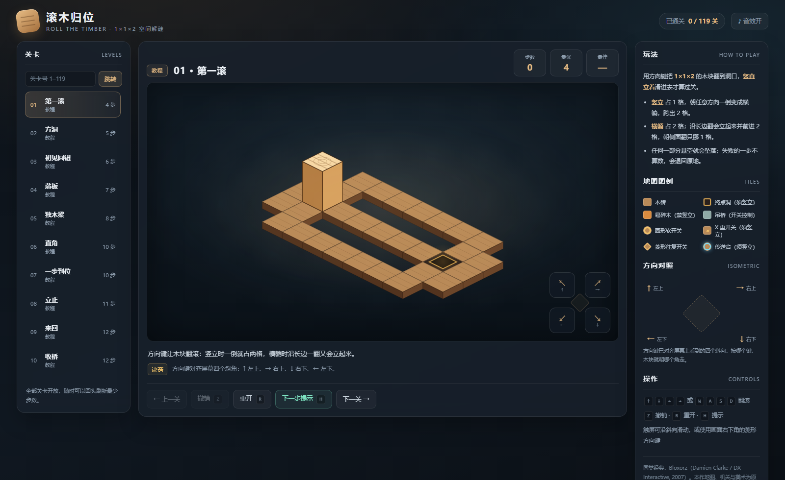
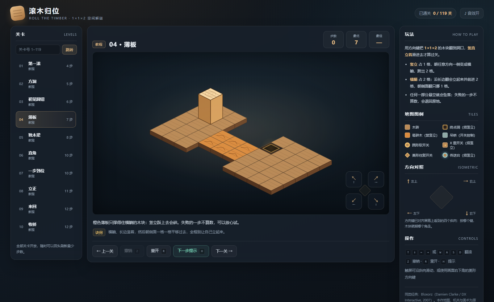
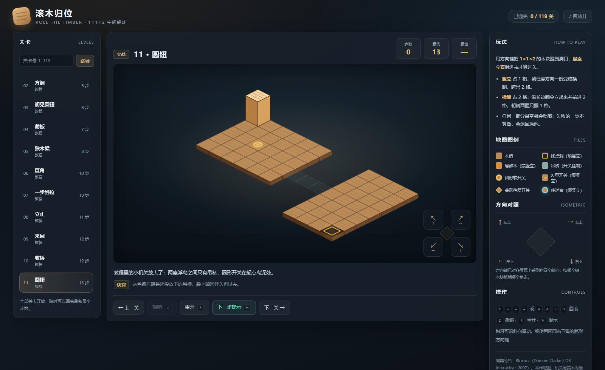
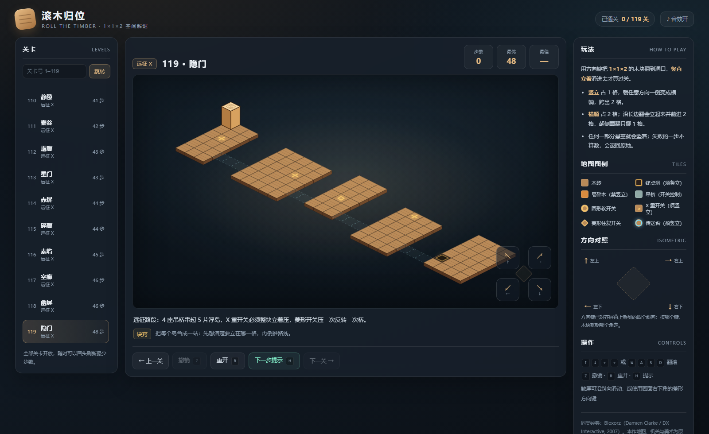
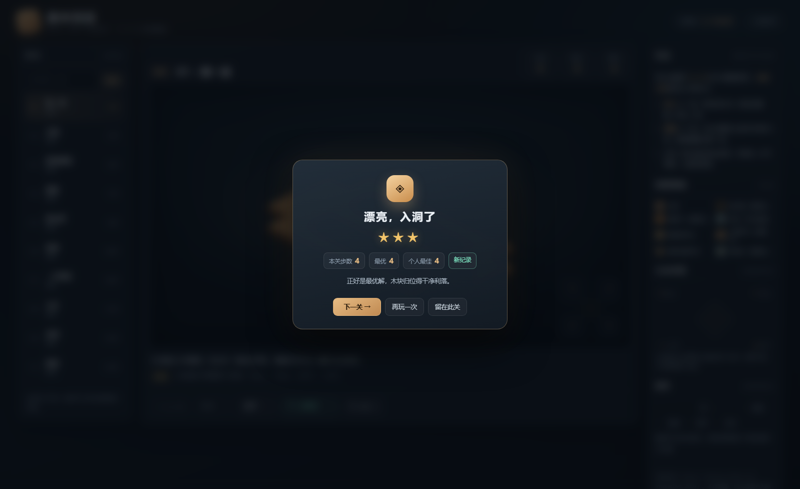

# 滚木归位 · Roll the Timber

一款离线可玩的等距翻滚解谜游戏：用方向键操纵 **1×1×2** 木块在悬浮木砖上翻滚，**竖直立住**并滑进发光方洞才算通关。

零依赖、无后端、无需构建：双击 `index.html` 就能玩；也可以打包成 Windows 单文件桌面应用。



## 玩法

- 木块竖立时占 1 格，朝任意方向一倒变成横躺，跨出 2 格。
- 横躺时占 2 格；沿长边翻会立起来并前进 2 格，朝侧面翻只挪 1 格。
- 任何一部分悬空就会坠落；失败的一步**不计步**，自动退回原地。
- 只有整块竖直立住落在洞口才算通关；横躺盖住洞口既不会掉下去，也不算过关。

### 方向键对应等距四向

屏幕上的四个斜角与按键一一对应：

| 按键 | 屏幕方向 |
| --- | --- |
| `↑` / `W` | 左上 |
| `→` / `D` | 右上 |
| `↓` / `S` | 右下 |
| `←` / `A` | 左下 |

画面右下角是同形状的菱形方向键；触屏可以沿斜向滑动。

## 机关

| 图例 | 作用 |
| --- | --- |
| 圆形软开关 `o` | 木块任意一部分压到即放下吊桥 |
| X 重开关 `x` | 必须整块**竖立**压上去 |
| 菱形往复开关 `t` | 每新压一次，桥在开 / 关之间反转 |
| 编号砖 `1`–`4` | 吊桥；灰色为未放下，踩对应开关才能通过 |
| 橙色易碎木 `~` | 只撑得住横躺，竖立踩上去会碎 |
| 青色传送台 | 只在木块**竖立**时启动，把整块送到对岸 |
| 发光方洞 `O` | 终点，须竖直滑入 |





## 119 关：从易到难

| 段落 | 关卡 | 内容 |
| --- | --- | --- |
| 教程 | 1–10 | 基础翻滚、竖直入洞、窄梁、转向；其中 6 关分别单独教一种机关 |
| 实战 | 11–19 | 放大版机关关、奇偶绕行、收桥陷阱、双桥综合 |
| 远征 I–X | 20–119 | 100 关程序化生成的浮岛链，分 10 章 |

每关都有 BFS 求得的**最短步数**（`par`），HUD 显示当前步数 / 最优 / 个人最佳；通关按步数给 1–3 星，进度存在浏览器 `localStorage`。全部关卡的最短步数 `4 → 48` 单调递增，119 张地图互不重复。

关卡数据是可读的 JSON（`src/levels.js` 的 `/*DATA*/` 区块，唯一数据源），`tools/verify_levels.py` 会逐关检查：可解、`par` 等于最短解、难度不倒退、**机关必须被最优解用到**。



## 运行

### 网页版

```bash
# 方式一：直接打开，无需服务端、无需联网、无需构建
#   双击 index.html（或用浏览器打开 file://.../index.html）

# 方式二：本地静态服务（Node.js 18+）
npm start                       # http://127.0.0.1:8080/
# 也可以用 Python
python -m http.server 8080
```

### Windows 桌面版

`dist/WoodGame.exe` 是单文件桌面应用（属于本地构建产物，未入库）：把内嵌资源解包到固定目录后，用 Edge / Chrome 的 `--app` 模式打开无地址栏独立窗口；固定 profile 保证通关进度不丢。

```bash
python -X utf8 desktop/build_desktop.py   # 需要 PyInstaller 与 Pillow
# 产物：dist/WoodGame.exe、dist/WoodGame-Windows-x64.zip
WoodGame.exe --selftest                   # 资源自检
```

## 操作

| 输入 | 作用 |
| --- | --- |
| 方向键 / WASD | 翻滚 |
| `Z` | 撤销一步 |
| `R` | 重开本关 |
| `H` | 提示：显示当前局面通往终点的最优下一步 |
| 关卡号输入框 | 跳到 1–119 任意一关 |
| 空格（通关后） | 下一关 |



## 验证

仓库内附带两套**独立实现**的求解器（Python 与 JavaScript），用于证明关卡可解并给出 `par`：

```bash
npm run verify                            # Python + JS 双引擎校验 119 关
python -X utf8 tools/verify_levels.py     # 逐关报告：步数 / 状态数 / 机关使用 / 最短解
python -X utf8 tools/verify_levels.py --trace 12
python -X utf8 tools/smoke_ui.py --sample # Playwright：主线 + 远征抽样真实按键通关
python -X utf8 tools/smoke_ui.py --all    # 全量 119 关（耗时较长）
python -X utf8 tools/generate_levels.py --count 100  # 可复现地重新生成远征关
```

实测记录：两套求解器的步数、状态数与解法路径逐关一致；Playwright 抽样（主线 19 关 + 远征 10 关）按最优解真实按键通关、控制台零错误；桌面 exe 的资源自检与独立窗口启动已确认。**未验证**：macOS / Linux 桌面包、真机移动端触屏、联网或多人功能（项目未实现）。项目没有独立的单元测试套件，上述验证由仓库内脚本完成。

## 代码结构

```text
index.html / styles.css        界面与样式
src/levels.js                 119 关数据（严格 JSON 区块，唯一数据源）
src/rules.js                  规则引擎：状态、几何、支撑、开关、传送
src/solver.js                 BFS 求解器（提示与关卡校验共用）
src/render.js                 Canvas 2D 等距渲染、绕棱翻滚与入洞动画
src/game.js                   输入、动画节拍、撤销、进度与界面
tools/verify_levels.py/.js    双实现关卡校验
tools/smoke_ui.py             浏览器通关回归（Playwright）
tools/generate_levels.py      程序化关卡生成
tools/serve.js                零依赖静态服务
desktop/                      PyInstaller 启动器与打包脚本
docs/screenshots/             本 README 配图（真实运行截图）
```

## 技术栈

原生 HTML5 / CSS3 / JavaScript（ES6，无框架、无构建步骤）、Canvas 2D 等距投影、WebAudio 即时合成音效、localStorage；Python 3（关卡生成 / 校验 / 打包）、Node.js（可选静态服务）、PyInstaller（Windows 打包）、Playwright（浏览器回归）。游戏运行时**不调用任何 AI 模型或外部服务**。

## 限制

- 第 20–119 关由参数化浮岛链模板生成，机关组合与地图各不相同，但整体骨架相近，不是逐张手工绘制。
- 纯离线单机：无服务端、账号、云存档或排行榜；进度仅在本地浏览器 profile。
- 桌面二进制只构建并自检于 Windows x64；网页版理论上可在其它平台的浏览器运行，但未实测。
- 响应式布局、虚拟方向键与触屏滑动已实现，未在真机移动端实测。
- 项目未包含 LICENSE 文件，也未声明许可证。

## 参考

规则原型参考 Bloxorz（Damien Clarke / DX Interactive, 2007）。本作的地图、机关、关卡、渲染与桌面打包均为重新实现与设计。
